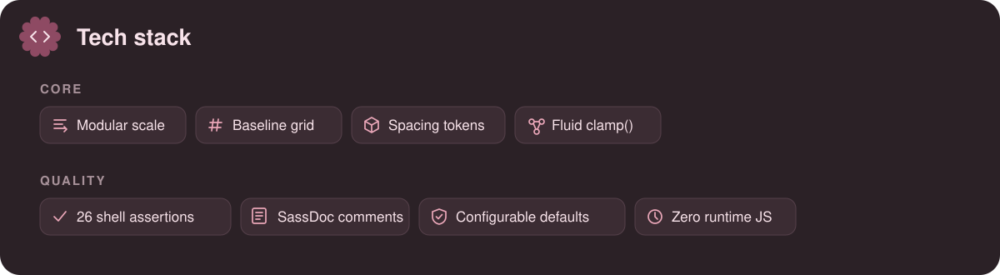

<p align="center">
  
</p>
<p align="center">
  <a href="https://github.com/Celine1337/rhythm/releases"></a>
  <a href="https://sass-lang.com/documentation/"></a>
  <a href="LICENSE"></a>
</p>


**rhythm** is a fluid-typography and vertical-rhythm toolkit written in modern Sass (SCSS modules). It compiles to a single plain-CSS file: a `clamp()`-based modular type scale, baseline-snapped line-heights, grid-aligned spacing tokens, responsive helpers and a debug overlay — with zero runtime JavaScript. Link the stylesheet and your page already has rhythm; `@use` the partials and you get a fully configurable Sass API instead.

The original idea: most fluid-type systems interpolate sizes but keep the scale *ratio* frozen. rhythm interpolates the ratio itself — a minor third (1.2) on phones widens to a perfect fourth (1.333) on desktop, so hierarchy strengthens exactly as room allows. And because every line-height is snapped **up** to whole baseline rows computed from each step's *largest* size, the fluid font can never outgrow its line box: the baseline grid holds at every viewport width, which unitless line-heights cannot promise.


- **Fluid modular scale** — nine named steps (`xs` … `4xl`), each one `clamp()` expression; both the base size and the ratio interpolate between 320px and 1280px anchors.
- **True vertical rhythm** — line-heights and block margins are whole multiples of a 0.5rem baseline; headings, captions and body text align across columns at any width.
- **Spacing tokens** — `--rhythm-space-1…8`, token *n* = *n* × baseline, so spacing and type share one grid by construction; plus fluid spacing via the same clamp engine.
- **Responsive helpers** — named breakpoints with `above()` / `below()` / `between()` mixins and `fluid-prop()` to make *any* length property fluid.
- **Baseline debug overlay** — one class paints the grid as a repeating gradient; see exactly what you are designing on.
- **Fully configurable** — every knob is `!default`: ratios, baseline, viewport anchors, step map, token prefix, breakpoints. One `@use … with` re-tunes the whole system.
- **Honest errors** — unknown steps, incompatible units and fractional token indexes fail the build with a readable Sass error instead of silent broken CSS.
- **Tested** — `test.sh` compiles fixtures and asserts the exact clamp math, tokens, selectors, media queries, reconfiguration and error paths (26 checks).




Requires Node.js (for the Dart Sass compiler) — nothing else at runtime.

```bash
git clone https://github.com/Celine1337/rhythm.git
cd rhythm
npm install         # installs the sass compiler (dev dependency)
./build.sh          # writes dist/rhythm.css
```

Then link it from any page:

```html
<link rel="stylesheet" href="dist/rhythm.css">
```

Open `index.html` after building to see the scale, the rhythm and the grid overlay in action.


**As plain CSS** — tokens and utilities are ready immediately:

```html
<h1>Display heading</h1>                     <!-- scale + rhythm by default -->
<p class="rhythm-fs-lg">Large fluid text</p>
<div class="rhythm-flow">…stacked blocks…</div>
<div class="rhythm-cols">…1 → 2 columns…</div>
<body class="rhythm-debug-grid">             <!-- baseline overlay -->
```

**As a Sass library** — configure once, use everywhere:

```scss
@use "rhythm/src/config" with (
  $prefix: "acme",
  $ratio-max: 1.5,
  $baseline: 0.25rem
);
@use "rhythm/src/main" as r;

h2        { @include r.type("xl"); }          // fluid size + snapped leading
.hero     { @include r.fluid-prop(padding-block, 2rem, 6rem); }
.sidebar  { @include r.above("md") { display: block; } }
.section  { @include r.pad(6); }              // 6 baseline rows
```

Key emitted tokens (default config):

| Token | Value |
| --- | --- |
| `--rhythm-fs-base` | `clamp(1rem, 0.9583rem + 0.2083vw, 1.125rem)` |
| `--rhythm-fs-4xl` | `clamp(2.986rem, 1.8775rem + 5.5425vw, 6.3115rem)` |
| `--rhythm-leading-base` | `1.5rem` (3 baseline rows) |
| `--rhythm-space-3` | `1.5rem` (one body line) |

Run the suite:

```bash
./test.sh           # 26 assertions → ALL CHECKS PASSED
```


MIT — see [LICENSE](LICENSE).